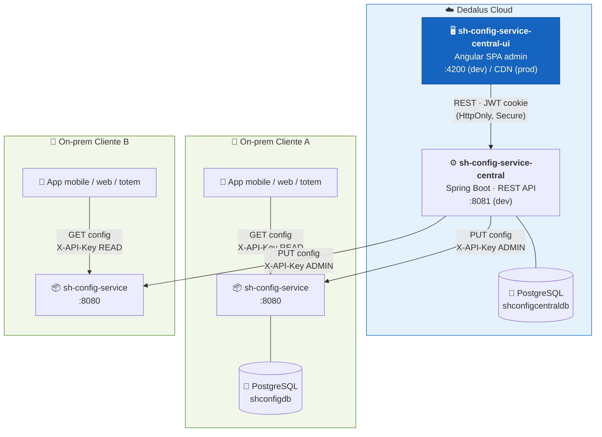
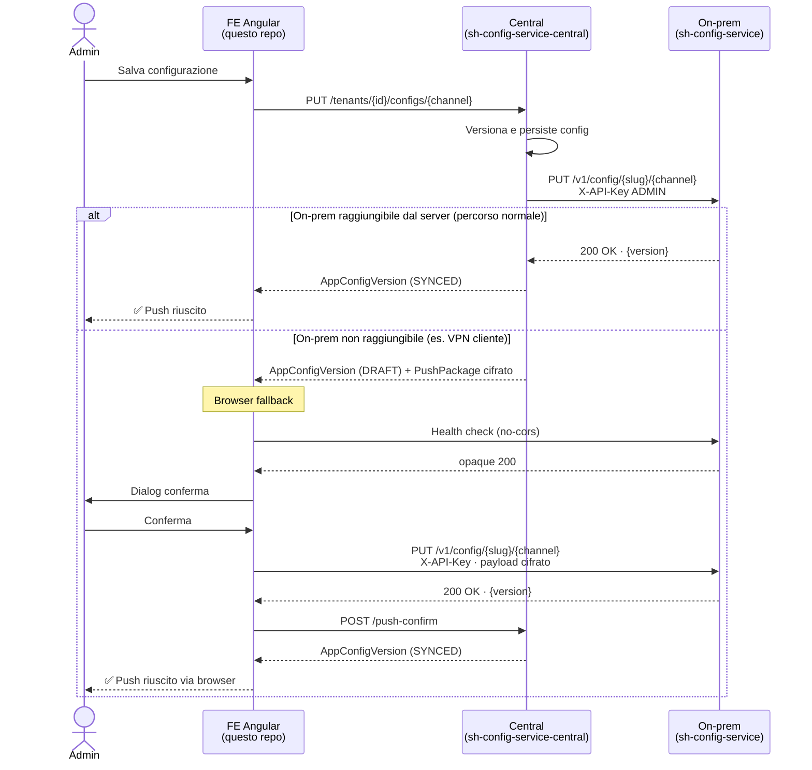
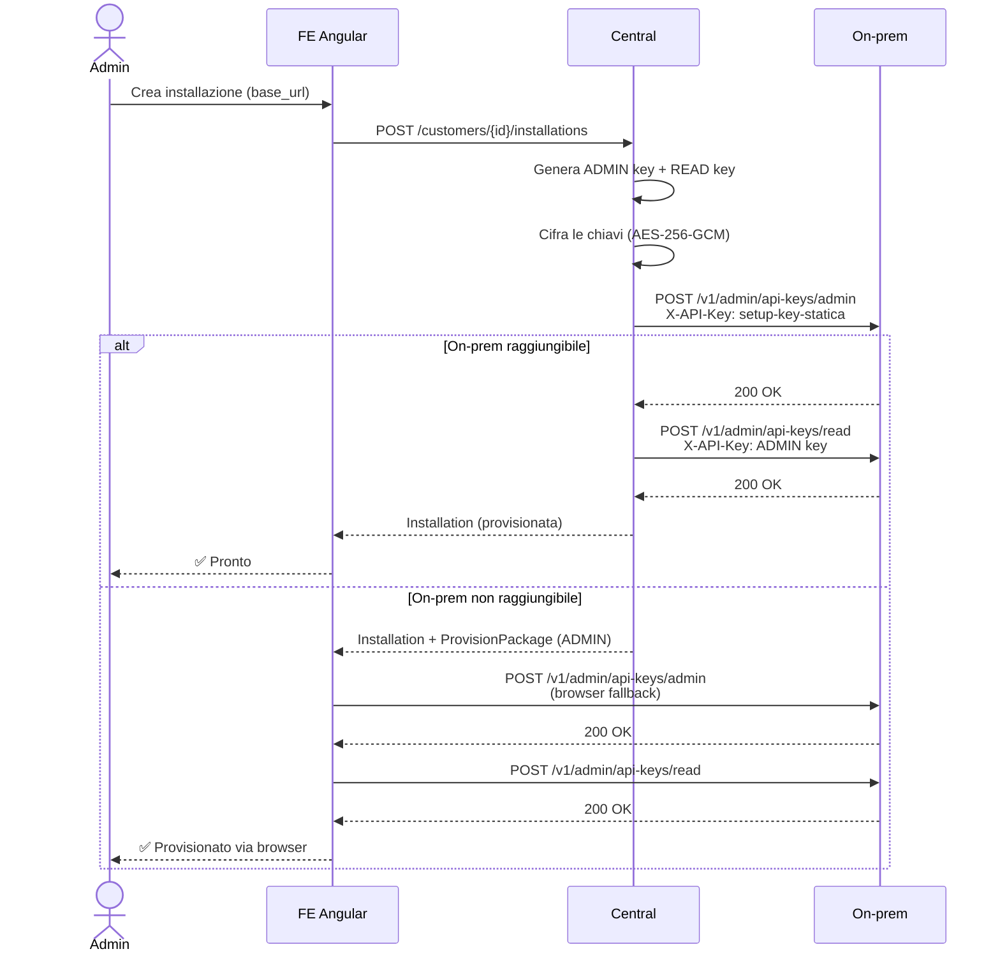

# sh-config-service-central-ui

Frontend Angular **admin** del configuratore centrale SmartHospital. SPA consumata dagli operatori interni Dedalus per gestire customer, installation on-prem, tenant, configurazioni applicative, utenti e audit log. Parla solo con il backend gemello `sh-config-service-central` (Spring Boot, JWT, REST).

---

## Architettura di sistema



> Questo repo è **solo la GUI**: non contiene logica di dominio. Ogni operazione viene delegata all'API del central.

---

## Sequence diagram — push configurazione



---

## Sequence diagram — provisioning on-prem (nuova installazione)



---

## Stack

- Angular 21.2 (standalone components, signals, routing)
- Angular Material 21.2 (tema azure-blue M3, typography globale, animations)
- TypeScript strict, SCSS
- Vitest per i test unitari
- Builder `@angular/build:application` (no SSR)

## Prerequisiti

- Node **20.19+** e npm 10+
- Backend `sh-config-service-central` in esecuzione su `http://localhost:8081` (vedi il README del repo gemello). In profilo `dev` ha già il CORS attivo per `http://localhost:4200`.

## Installazione

```bash
npm install
```

## Avvio dev server

```bash
npm start
```

Apre `http://localhost:4200/` con hot reload. Le chiamate API andranno a `http://localhost:8081/api`.

Credenziali admin di default sul backend locale:

```
username: emiliano.auricchio@dedalus.com
password: DedalUs4$!
```

## Build di produzione

```bash
npm run build
```

Output in `dist/sh-config-service-central-ui/`. In prod il bundle viene servito da nginx/CDN dietro lo stesso reverse proxy del backend, quindi same-origin (niente CORS).

## Test

```bash
npm test
```

Vitest esegue i `*.spec.ts` nel sorgente.

## Struttura cartelle

```
src/
├── environments/
│   ├── environment.ts             # prod (apiBaseUrl: '/api')
│   └── environment.development.ts # dev  (apiBaseUrl: 'http://localhost:8081/api')
└── app/
    ├── core/
    │   └── auth/                  # AuthService (signal), interceptor JWT, guard
    ├── layout/
    │   └── admin-shell/           # sidenav + toolbar, parent delle route protette
    ├── features/
    │   ├── auth/pages/login-page/
    │   ├── home/pages/home-page/          # dashboard ADMIN: KPI, alert DRAFT, grafici
    │   ├── home/pages/customer-home-page/ # dashboard CUSTOMER: KPI, alert DRAFT, salute installation
    │   ├── customers/             # lista + dettaglio + create dialog
    │   │   ├── customers.routes.ts
    │   │   ├── models.ts
    │   │   ├── services/customers.ts
    │   │   ├── pages/{customers-page,customer-detail-page}/
    │   │   └── dialogs/customer-create-dialog/
    │   ├── installations/         # dettaglio /installations/:id + sezione embedded in CustomerDetail
    │   │   ├── installations.routes.ts
    │   │   ├── models.ts
    │   │   ├── services/installations.ts
    │   │   ├── pages/installation-detail-page/
    │   │   ├── components/customer-installations-section/
    │   │   └── dialogs/{installation-create,rotate-api-key,rotate-read-api-key,rotate-payload-master-key,show-payload-master-key}-dialog/
    │   └── tenants/               # configurazioni per tenant/canale/entity
    │       ├── models.ts
    │       ├── services/tenants.ts
    │       ├── components/
    │       │   ├── config-channel-section/     # editor JSON + history + resync
    │       │   ├── installation-tenants-section/
    │       │   └── smh-phone-preview/          # mockup telefono live
    │       └── dialogs/
    │           ├── smh-ui-render-editor-dialog/    # editor grafico home screen mobile
    │           ├── smh-spid-provider-editor-dialog/ # editor grafico provider SPID
    │           ├── smh-faq-editor-dialog/           # editor grafico FAQ
    │           ├── config-version-diff-dialog/
    │           └── _smh-editor-base.scss            # mixin SCSS condiviso dagli editor SMH
    └── shared/
        ├── components/svg-upload-field/ # campo upload SVG con anteprima
        ├── dialogs/confirm-dialog/
        └── services/recaptcha-v3.ts    # carica enterprise.js e genera token
```

## Funzionalità principali

### Dashboard admin

Visibile solo agli utenti ADMIN (route `/`). Mostra:

- **5 KPI card**: clienti attivi, on-prem online, utenti attivi, azioni di oggi, tasso di successo
- **KPI on-prem online**: caricamento progressivo — per ogni installation attiva lancia un health check direttamente dal browser e aggiorna il contatore in tempo reale
- **Alert DRAFT**: se ci sono configurazioni non sincronizzate (`GET /configs/draft`), viene mostrata una tabella con customer, installation, prodotto, canale, entity, versione ed errore — link diretto al prodotto
- **Grafici Chart.js**: attività giornaliera (ultimi 30 giorni, line chart), stato clienti (doughnut), top 10 azioni per tipo (bar orizzontale)

### Dashboard customer

Visibile agli utenti con ruolo CUSTOMER (route `/my-dashboard`). Mostra:

- **3 KPI card**: installation attive, on-prem online (health check browser-direct), configurazioni non sincronizzate
- **Alert DRAFT**: tabella delle configurazioni in stato DRAFT del proprio customer (canale, entity, versione, errore)
- **Tabella installation**: tutte le installation del customer con nome, URL, stato salute (health check browser-direct) e stato attivo/inattivo

### Gestione configurazioni

- Editor JSON con syntax validation, history delle versioni, rollback con confronto diff
- **Entity obbligatorie per canale mobile**: `smh_ui_render`, `smh_spid_provider`, `smh_faq`, `smh_link_service_config`, `smh_service_config` compaiono sempre nella barra entity (anche senza config salvata), con default strutturati invece di `{}`
- Sezione JSON collassata di default per le entity che hanno un editor grafico

### Editor grafici SMH (canale mobile)

| Entity | Cosa gestisce |
|--------|---------------|
| `smh_ui_render` | Home screen dell'app: app bar, banner, categorie + servizi (griglia 2 colonne), navigation bar |
| `smh_spid_provider` | Lista provider SPID (id, nome, icona SVG) con drag-and-drop |
| `smh_faq` | Domande frequenti (id, domanda, risposta) con drag-and-drop |

Caratteristiche comuni:
- Drag-and-drop per riordinare gli elementi
- Upload SVG con anteprima inline (decodifica sia raw SVG che base64)
- ID servizi con autocomplete filtrato (esclude ID già in uso per evitare duplicati)

### Preview mobile live

Visibile a destra dell'editor quando si modifica `smh_ui_render` sul canale mobile. Aggiorna in tempo reale mentre si edita il JSON. Mostra:
- App bar con logo (dimensione naturale) e barra di stato
- Banner header (se `show_card: true`)
- Griglia categorie/servizi con icone, badge link (🔗) e lucchetto (🔒) dove applicabile
- Navigation bar con icone

Il badge link compare solo se l'ID del servizio è presente in `smh_link_service_config`.

### Health check on-prem (solo ADMIN)

Nella lista installation del dettaglio customer: colonna **"Stato on-prem"** con:
- Spinner durante il controllo
- Pallino verde = on-prem raggiungibile (qualsiasi risposta HTTP)
- Pallino rosso = timeout o connection refused

I controlli partono in parallelo al caricamento della lista e si aggiornano progressivamente.

### Provisioning installazione (zero-touch)

Il flusso di setup di una nuova installazione on-prem dalla UI:

1. Avviare l'on-prem (solo config DB necessaria) — il `DataInitializer` genera la **ADMIN key** e la stampa nei log.
2. Nel central UI: aprire il dettaglio del customer → sezione "Installazioni" → pulsante "Nuova installazione".
3. Inserire nome, `baseUrl` dell'on-prem e la ADMIN key copiata dai log.
4. Il central provisiona automaticamente la **READ key** sull'on-prem e crea il collegamento.

La sezione **Sicurezza** nella pagina di dettaglio di ogni installazione espone:

| Voce | Azione disponibile | Descrizione |
|------|--------------------|-------------|
| API key (ADMIN key) | Mostra, Ruota | Chiave usata dal central per push/provisioning verso l'on-prem |
| READ key client | Mostra, Ri-provisiona, Ruota | Chiave usata dai client app (mobile/web/totem) per `GET /config/...` direttamente sull'on-prem |
| Payload master key | Mostra | Chiave AES-256 per cifratura payload in transito; deve corrispondere a `CRYPTO_MASTER_KEY` sull'on-prem |

I client leggono le config direttamente dall'on-prem:
```
GET {onPremBaseUrl}/api/v1/config/{tenantSlug}/{channelId}?entity=base
X-API-Key: <READ key>
```

### Browser fallback (VPN / on-prem behind NAT)

Se il server centrale non raggiunge l'on-prem del cliente (es. behind VPN), il browser dell'admin — già in VPN — funge da proxy di rete per due tipi di operazioni:

**Push configurazioni (`PushPackage`)** — implementato in `config-channel-section.ts`:
1. Il central tenta il push → fallisce → salva la config come `DRAFT` + ritorna `pushPackage: { encryptedPayload, apiKey, targetUrl, baseUrl }`
2. Il FE fa un health check dal browser verso `{baseUrl}/actuator/health`
3. Se raggiungibile: dialog di conferma → `fetch(targetUrl, PUT)` con `X-API-Key: apiKey` → `POST .../push-confirm` al central per aggiornare lo stato a `SYNCED`

**Provisioning risorse (`ProvisionPackage`)** — implementato in `installation-detail-page.ts` e `tenant-create-dialog.ts`:
1. Il central tenta il provisioning (READ key o tenant) → fallisce → salva la risorsa nel proprio DB + ritorna `provisionPackage: { adminApiKey, targetUrl, body }`
2. Il FE fa health check, dialog di conferma, poi `fetch(targetUrl, POST, { X-API-Key: adminApiKey, body })`
3. **Nessun confirm verso il central** — la risorsa è già salvata nel DB centrale

Casi di provisioning via browser:
- `POST .../read-api-key/provision` → fallback: `POST {baseUrl}/v1/admin/api-keys/read`
- `POST .../read-api-key/rotate` → fallback: stesso endpoint (con nuova key)
- `POST .../tenants` (creazione tenant) → fallback: `POST {baseUrl}/v1/admin/tenants`

## Auth

- Login: `POST /api/auth/login` → `{token, expiresAt}` salvato in `localStorage` (`sh.cs.authToken`, `sh.cs.authTokenExpiresAt`).
- Identità: `GET /api/auth/me` chiamato dopo il login e dal route guard quando il token è in storage ma il signal è vuoto (caso refresh).
- Interceptor: attacca `Authorization: Bearer <token>` a tutte le chiamate verso `apiBaseUrl` eccetto `/auth/login`. Su `401` pulisce lo stato e redirige a `/login?returnUrl=...`.
- Guard: `authGuard` (functional `CanActivateFn`) protegge le route che richiedono utente loggato.

### reCAPTCHA Enterprise

La login usa **Google reCAPTCHA Enterprise** (score-based, invisibile). Il widget appare in basso a destra sulla pagina di login.

- Chiave sito: configurata in `environment.ts` → `recaptchaSiteKey`
- Il flag `captchaEnabled` in environment permette di disabilitare il captcha (es. test automatici). In dev e prod è `true`.
- Il service `shared/services/recaptcha-v3.ts` carica `enterprise.js` dinamicamente e chiama `grecaptcha.enterprise.execute()`.
- Il token viene inviato al backend nel campo `captchaToken` del body di login; il backend lo verifica tramite l'Assessment API di Google.

## Layout admin

- `AdminShell` è la shell per tutte le route protette: sidenav responsive (side su desktop, over su mobile) + toolbar con utente/ruolo/logout.
- Voci di navigazione in `AdminShell.navItems`: `icon`, `label`, `path` opzionale, `requiredRole` opzionale.
- **Footer fisso** in calce all'area di contenuto (e sulla pagina di login): ragione sociale, sede e P.IVA di Dedalus Italia S.p.A. + nota sull'uso esclusivo di cookie tecnici.

## Convenzioni

- Errori utente in **italiano**, log misti.
- Niente `any` se evitabile.
- Commit message in italiano, descrittivi.
- README e CLAUDE.md vanno aggiornati nello stesso commit che cambia script/setup/struttura.

## Contesto architetturale

Per il quadro completo (endpoint API, flussi push, channel statici, decisioni di stack, roadmap) vedi `CLAUDE.md` in questo repo.
